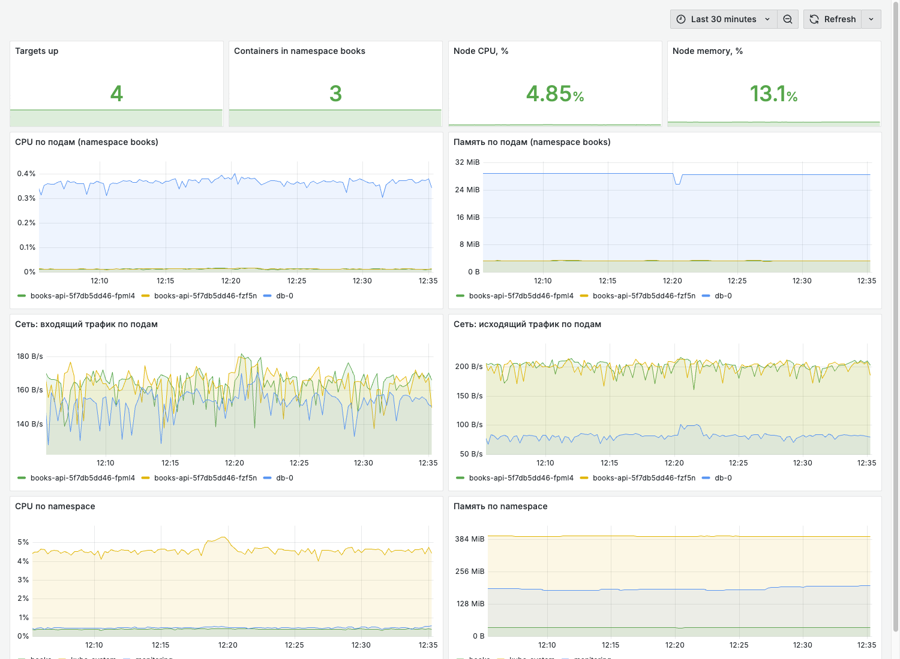

# ЛР 12. Kubernetes (Minikube): приложение из ЛР 11 + Prometheus и Grafana

Микросервис книг из [ЛР 11](https://github.com/ischademadda/devops-lab11-books-service) (Go + PostgreSQL) в кластере Minikube
с мониторингом на Prometheus и Grafana.

Среда: Ubuntu 24.04 (виртуальная машина), Docker 29, Minikube v1.39.0 (драйвер `docker`), Kubernetes v1.37.

## Структура

```
deploy.sh                      # развернуть всё одной командой
k8s/app/                       # namespace books: PostgreSQL (StatefulSet + PVC) и books-api (Deployment x2)
k8s/monitoring/                # namespace monitoring: Prometheus + Grafana (kustomize)
  prometheus.yml               #   конфиг сбора метрик
  dashboards/books-overview.json  # дашборд Grafana
docs/grafana-dashboard.png     # скриншот дашборда
```

## Basic

### 1. Установка и проверка

```bash
# kubectl и minikube — официальные бинарники, контрольные суммы проверены
minikube version        # minikube version: v1.39.0
minikube start --driver=docker --cpus=2 --memory=3072mb
kubectl version         # Client v1.37.2, Server v1.37.0
minikube status         # host / kubelet / apiserver: Running
```

### 2. Структура кластера

```bash
kubectl cluster-info    # control plane https://192.168.49.2:8443, CoreDNS
kubectl get nodes -o wide
# NAME       STATUS   ROLES           VERSION   INTERNAL-IP    CONTAINER-RUNTIME
# minikube   Ready    control-plane   v1.37.0   192.168.49.2   containerd://2.3.4
kubectl get pods -A     # etcd, apiserver, scheduler, controller-manager, coredns, kube-proxy ...
```

### 3. Развёртывание приложения

Образ собирается из исходников ЛР 11 прямо внутри minikube (отдельный registry не нужен):

```bash
git clone https://github.com/ischademadda/devops-lab11-books-service.git
minikube image build -t books-api:1.0 devops-lab11-books-service
kubectl apply -f k8s/app/
kubectl get deployments -n books
# NAME        READY   UP-TO-DATE   AVAILABLE
# books-api   2/2     2            2
```

Что внутри `k8s/app/`:

- `db` — StatefulSet с `postgres:16-alpine`, данные на PVC 1Gi (переживают пересоздание пода), креды в Secret, readiness/liveness через `pg_isready`;
- `books-api` — Deployment на 2 реплики, строка подключения из Secret, `startupProbe` + readiness/liveness на `/health`,
  лимиты ресурсов, `runAsNonRoot`, `readOnlyRootFilesystem`, `drop ALL capabilities`;
- Service `books-api` (NodePort 30080) и `db` (ClusterIP).

Проверено: создание/чтение книг, ошибки валидации (422), балансировка между репликами,
self-healing (при удалении пода Deployment поднимает новый, данные на месте).

## Intermediate — `kubectl proxy`

```bash
kubectl proxy --port=8001 --address=127.0.0.1 &

curl http://127.0.0.1:8001/version
curl http://127.0.0.1:8001/api/v1/nodes
# приложение через прокси к API-серверу:
curl http://127.0.0.1:8001/api/v1/namespaces/books/services/books-api:http/proxy/health
curl http://127.0.0.1:8001/api/v1/namespaces/books/services/books-api:http/proxy/books
```

Порт 8001 выбран потому, что 8000 занят docker-compose из ЛР 11.
Прокси слушает только localhost; с другой машины — через ssh-туннель `ssh -L 8001:127.0.0.1:8001 <host>`.

## Advanced — Prometheus и Grafana

```bash
kubectl apply -k k8s/monitoring
```

- **Prometheus** (`prom/prometheus:v2.55.1`) собирает метрики через service discovery Kubernetes:
  cAdvisor (CPU / память / сеть каждого контейнера), kubelet, kube-apiserver, сам Prometheus,
  а также любые поды с аннотацией `prometheus.io/scrape: "true"`. Права — через ServiceAccount + ClusterRole.
- **Grafana** (`grafana/grafana:11.3.1`): источник данных и дашборд **Lab 12 — Books on Kubernetes**
  создаются автоматически (provisioning), ничего вручную настраивать не нужно.



Дашборд: число живых таргетов, контейнеры в `books`, загрузка CPU/памяти ноды, CPU, память и сетевой трафик по подам, CPU и память по namespace.

### Доступ к интерфейсам

Minikube-сеть (`192.168.49.2`) доступна только на самой ВМ. С локальной машины — ssh-туннель:

```bash
ssh -p <порт> -L 3000:192.168.49.2:30030 -L 9090:192.168.49.2:30090 <user>@<host>
# Grafana:    http://localhost:3000   (admin / admin-lab12)
# Prometheus: http://localhost:9090/targets
```

> Учебные пароли (`admin-lab12`, `books/books`) лежат в манифестах открыто. В реальном окружении — внешний секрет-менеджер.

## Развернуть с нуля

```bash
./deploy.sh
```

Скрипт при необходимости стартует minikube, собирает образ из репозитория ЛР 11, применяет манифесты и дожидается готовности.
Повторный запуск безопасен.

## Замечания

- История метрик Prometheus хранится в `emptyDir` и теряется при пересоздании пода (для учебного стенда достаточно).
- Число реплик API задаётся в манифесте; ручной `kubectl scale` будет откатан следующим `kubectl apply`.
- CI/CD (опциональный пункт 6) не делался.
